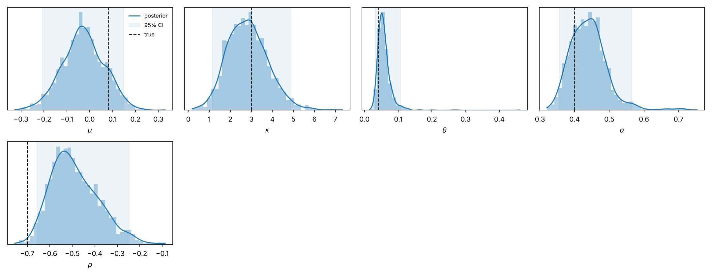
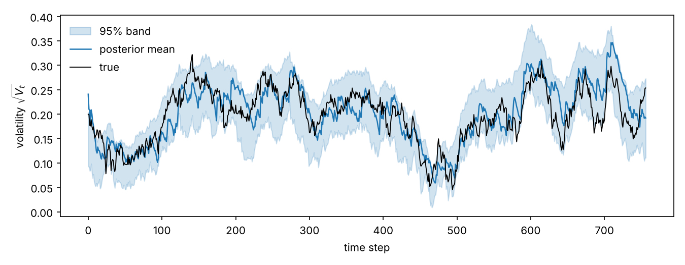
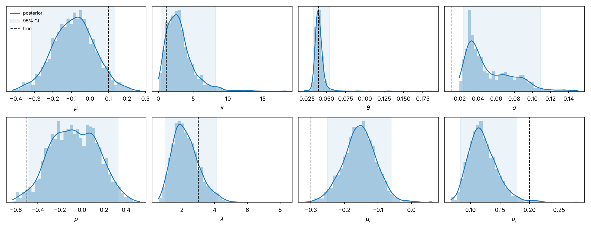

# Synthetic-data results

These runs use `scripts/run_synthetic.py` with `--iter 2000` (500 burn-in),
1000 particles, `path="ffbs"`, seed 1 and 3 years of daily data.

All runs use the same weakly informative priors:
- `kappa ~ 2 ± 2`
- `theta ~ 0.05 ± 0.05`
- `rho ~ -0.3 ± 0.4`
- `lam ~ 1 ± 1`
- `mu_J ~ -0.05 ± 0.3`

The priors are deliberately *not* centred on the truth. Each run takes
about 7–10 minutes on one CPU core.

Reproduce:

```bash
python scripts/run_synthetic.py --model heston --preset realistic --iter 2000
```

## Heston, realistic parameters

True values: `mu=0.08, kappa=3, theta=0.04, sigma=0.4, rho=-0.7`.

| param | true | mean | 95% CI | ESS |
|---|---|---|---|---|
| mu | 0.08 | -0.027 | [-0.21, 0.15] | 569 |
| kappa | 3.0 | 2.83 | [1.14, 4.86] | 354 |
| theta | 0.04 | 0.058 | [0.033, 0.107] | 1362 |
| sigma | 0.40 | 0.440 | [0.355, 0.565] | 43 |
| rho | -0.70 | -0.488 | [-0.657, -0.247] | 60 |




The latent-variance MSE is 2.1e-4, against a variance of 4.2e-4 for the
true path.

`rho` is under-estimated in magnitude. Given the *true* variance path, the
same data give `rho = -0.67 [-0.71, -0.64]`. The attenuation therefore comes
from the uncertainty in the latent path, together with slow mixing (ESS 60),
not from the regression itself. Exact particle Gibbs (conditional SMC with
ancestor sampling) is the natural next step if this matters.

## Heston / Bates with the thesis' tiny vol-of-vol (`sigma = 0.01`)

| model | sigma: true → posterior | rho: true → posterior |
|---|---|---|
| Heston | 0.01 → 0.035 [0.023, 0.057] | -0.5 → 0.00 [-0.40, 0.39] |
| Bates | 0.01 → 0.052 [0.024, 0.109] | -0.5 → -0.07 [-0.48, 0.33] |

With `sigma = 0.01` the variance stays within about ±0.001 of `theta`. Daily
returns then contain essentially no information about `sigma` or `rho`, and
the posterior falls back to the prior. `theta` is still recovered: 0.0416
(Heston) and 0.0408 (Bates).

The thesis obtained good `sigma` and `rho` estimates in this setting
because its priors were tight and centred near the truth (see
CODE_REVIEW 1.4).

## Bates jumps (thesis preset: `lam=3, mu_J=-0.3, sigma_J=0.2`)

This simulated path contains 8 jumps. Their sample mean is **-0.158** and
their sample sd **0.131**: milder than the generating values.

| param | posterior | what the sample actually contains |
|---|---|---|
| lam | 2.25 [0.97, 4.12] | 8 jumps / 3 yr = 2.67 |
| mu_J | -0.154 [-0.25, -0.06] | -0.158 |
| sigma_J | 0.122 [0.083, 0.179] | 0.131 |
| jumps detected per sweep | median 8 | 8 |



The sampler recovers the jumps that are in the data. With 1 year of data (1–2
jumps) the jump posteriors stay close to the prior, as the thesis found.

## Option-price uncertainty

The option is a 1-month call at 110% of spot, with `r = 5%`.

| run | true price | posterior MC mean ± sd | PCE mean ± sd (LOO err) | dominant Sobol index |
|---|---|---|---|---|
| Heston realistic | 0.167 | 0.071 ± 0.060 | 0.072 ± 0.061 (0.1%) | v0 (0.96) |
| Heston thesis | 0.112 | 0.120 ± 0.061 | 0.119 ± 0.032 (0.0%) | v0 (0.81) |
| Bates realistic | 0.207 | 0.102 ± 0.115 | 0.121 ± 0.135 (9%) | mu_J (0.65) |
| Bates thesis | 0.220 | 0.089 ± 0.035 | 0.089 ± 0.036 (0.5%) | lam (0.62) |

- The PCE mean matches the exact posterior Monte Carlo. In three of the four
  runs the error is at most about 2% of a price sd; in Bates realistic,
  where the PCE fit is worst (LOO error 9%), the gap is about 17%. The PCE
  sd matches too, except in the Heston thesis run, where `v0` has a
  long-tailed posterior that an order-3 polynomial in a Gaussian germ
  cannot represent. Use the MC route when the LOO error or that gap is large.
- For short-dated options the spot variance `v0` and the jump parameters
  dominate the price uncertainty. `kappa`, `theta`, `sigma` and `rho`
  contribute little.
- The true price is *below the posterior mean* in one run and above it in
  the others. In the Bates thesis run the gap reflects the milder jumps in
  this particular sample (see above), not a pricing error.
